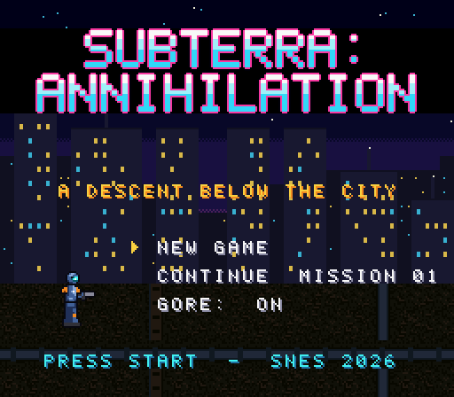
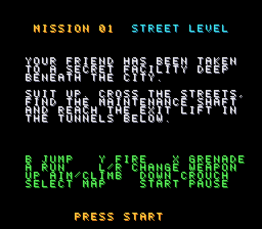
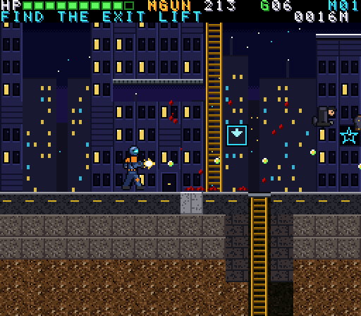
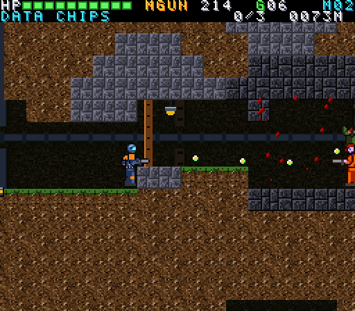
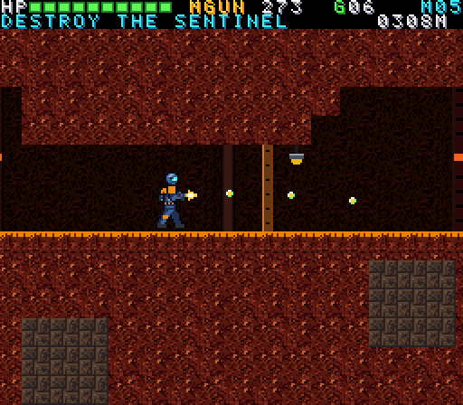
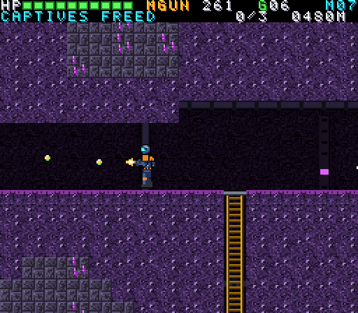
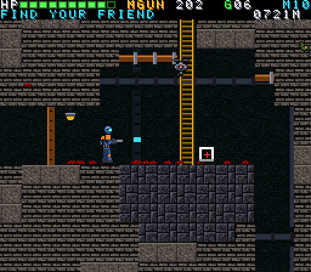

# Subterra: Annihilation (SNES)

A real Super Nintendo game: a side-scrolling sci-fi action/exploration game in
which a soldier in powered armor descends from a neon city into an enormous
ant-colony labyrinth to rescue a captured friend. 10 missions.

- Download the ROM (`.sfc`) from the
  [latest release](https://github.com/Bryantlee7/subterra-annihilation-snes/releases/latest)
  and run it in any SNES emulator (e.g. Snes9x, bsnes, Mesen)

## Screenshots

<table>
  <tr>
    <td><br>Title screen</td>
    <td><br>Mission briefing and controls</td>
  </tr>
  <tr>
    <td><br>Mission 1: Street Level</td>
    <td><br>Mission 2: The Nest</td>
  </tr>
  <tr>
    <td><br>Mission 5: The Sentinel</td>
    <td><br>Mission 7: Prisoners</td>
  </tr>
  <tr>
    <td colspan="2"><br>Mission 10: The Facility</td>
  </tr>
</table>

Controls: **B** jump, **Y** fire, **X** grenade, **A** run, **L/R** change
weapon, **Up** aim/climb, **Down** crouch, **Select** map, **Start** pause.

## Building

Requirements: `ca65`/`ld65` (cc65 package), Python 3 with Pillow.

```sh
python3 build.py                 # -> build/game.sfc (512KB LoROM, FastROM, 2KB SRAM)
python3 build.py --mission 4     # testing: boot straight into mission 4
```

## Testing

`tools/run_test.py` builds a test ROM with scripted joypad input, runs it in
mednafen headlessly (xvfb), and extracts video frames plus debug values that
the test build writes to SRAM (player position, health, lag frames, a CPU
profile in scanlines per subsystem).

```sh
# script: one line per step, "<frames> <buttons...>" or "WARP <x> <y>"
python3 tools/run_test.py mytest 8 --mission 2 --script steps.txt --every 30
python3 tools/audio.py scratch/mytest/run.mov out.wav    # audio track + loudness
python3 tools/sym.py 8A3F                                # address -> routine
python3 tools/entpos.py 6                                # objective positions
```

## Layout

| Path | What |
|---|---|
| `src/main.s` | boot, NMI (DMA uploads, scrolling, HDMA parallax), state machine |
| `src/map.s` | 128x64 metatile maps, camera, tile streaming, collision, destructible terrain, doors, lasers |
| `src/player.s` | movement, ladders, crouch/aim, damage, visual-only armor/limb loss |
| `src/weapons.s` | machine gun, grenades, plasma, EMP, railgun; enemy shots |
| `src/actors.s` | enemies + objects: AI, hit zones, severed parts (with ability loss), pickups, objectives |
| `src/fx.s` | particles: blood, sparks, debris, explosions, smoke, beams |
| `src/hud.s`, `src/screens.s`, `src/text.s` | HUD, title/briefing/map/results/ending, mission text |
| `src/sound.s` | SPC700 upload and command queue |
| `tools/sprites.py`, `tools/tiles.py` | procedural pixel art (sprites, tiles, backdrops, font, logo) |
| `tools/levels.py` | ant-colony maze generator for the 10 missions + reachability validator |
| `tools/sound.py`, `tools/spc.py` | SPC700 sound driver (written with a tiny Python assembler), BRR samples, SFX, music |

The game title shown on the logo comes from the `TITLE` file.
